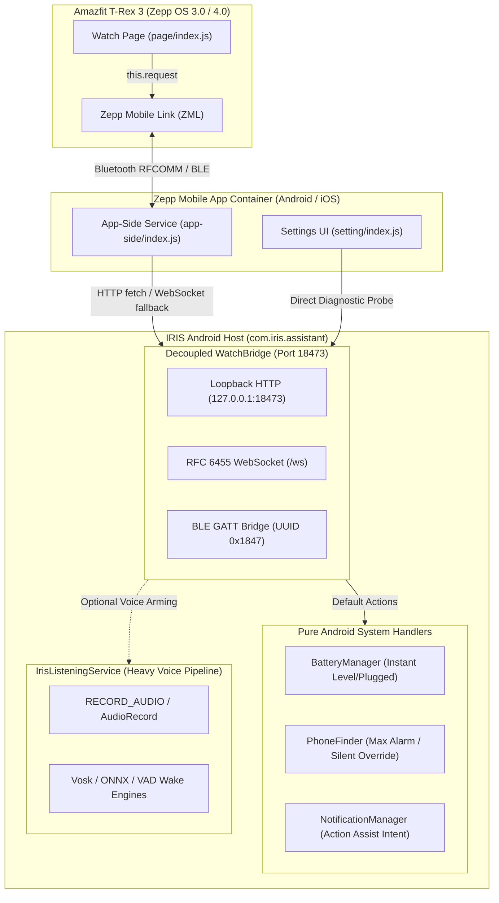

# Companion App Architecture, Development & Troubleshooting Manual

> **Reference Specification & Practical Guide for Smartwatch Companion Development and Troubleshooting**  
> Covers: **Zepp OS (Amazfit T-Rex 3)** &bull; **Android 14+ (targetSdk 35)** &bull; **Dual-Transport Bridge (HTTP/WebSocket/BLE)** &bull; **Lifecycle Decoupling** &bull; **Security & Pairing**

---

## 1. System Architecture Overview

The companion ecosystem consists of three decoupled layers:



### The Three Tiers
1. **Watch Mini-App (`IRIS-Watch/page/index.js`)**: Runs on the smartwatch (Amazfit T-Rex 3, 480&times;480 circular AMOLED). Communicates with the phone companion via `@zeppos/zml` (`this.request({ method: 'IRIS', action })`).
2. **Phone Companion Container (`IRIS-Watch/app-side/index.js` & `IRIS-Watch/setting/index.js`)**: Runs inside the Zepp mobile app sandbox on the user's phone. Routes watch requests to the local Android host via loopback network calls.
3. **Android Host Service (`IRIS-Android/app/src/main/java/com/iris/assistant/WatchBridge.java`)**: Runs inside the IRIS Android process, listening on `127.0.0.1:18473` and managing authentication, token rotation, and phone hardware execution.

---

## 2. Hard-Won Architectural Lessons (Never Repeat These Mistakes)

### Lesson 1: Never Couple Companion Sockets to Foreground Voice Services
* **The Antipattern**: Requiring the voice assistant foreground service (`IrisListeningService`) to run in order for the watch to check battery, ring the phone, or test connectivity.
* **Why it failed**:
  1. Users misplace their phones when the voice assistant is **resting**; finding the phone is useless if the voice assistant must already be running.
  2. Starting `IrisListeningService` initializes heavy native libraries (Vosk, ONNX, VAD), requests exclusive `RECORD_AUDIO` microphone hardware focus, and triggers wake training checks.
  3. In Android 14+ (targetSdk 35), starting foreground services from background threads or without main UI interactions triggers `ForegroundServiceStartNotAllowedException`, instantly crashing the app.
* **The Rule**: Companion bridges must be managed as **independent shared singletons (`WatchBridge.startShared(Context)`)** using lightweight, pure Android system services (`BatteryManager`, `PhoneFinder`, `NotificationManager`) that require zero audio permissions and never crash.

### Lesson 2: Android WebView Cleartext HTTP (`http://`) Blacklist
* **The Antipattern**: Relying solely on `fetch('http://127.0.0.1:18473/...')` inside the Zepp companion settings page (`setting/index.js`).
* **Why it failed**: In Android 9+ (API 28+), Android WebViews enforce `cleartextTrafficPermitted=false`. Even though `127.0.0.1` is loopback, WebViews running inside third-party containers (like Zepp) reject cleartext HTTP requests with generic `NetworkError` or `Failed to fetch`.
* **The Solution**: Dual-protocol fallback.
  1. Try `http://127.0.0.1:18473`.
  2. Fallback to `http://localhost:18473`.
  3. Fallback to RFC 6455 WebSocket: `ws://127.0.0.1:18473/ws`. WebViews permit loopback WebSocket connections even when cleartext HTTP fetch is blocked!

### Lesson 3: Zepp OS Controlled vs. Uncontrolled Inputs
* **The Antipattern**: Passing `value: token` to `TextInput` in `setting/index.js`:
  ```javascript
  TextInput({
    settingsKey: 'irisToken',
    value: token // <-- BUG!
  })
  ```
* **Why it failed**: In Zepp OS Settings, `TextInput` automatically syncs with `settingsStorage` via `settingsKey`. Passing `value: token` makes the component controlled, causing typing or pasting to glitch, lag, or overwrite clipboard contents with stale state.
* **The Solution**: Omit `value`. Let `settingsKey` manage storage and extract the key cleanly in `onChange`.

### Lesson 4: Android `AlertDialog.Builder` Message Collision
* **The Antipattern**: Calling `.setMessage()` alongside `.setItems()`:
  ```java
  new AlertDialog.Builder(this)
      .setTitle("Watch Bridge")
      .setMessage("Status: Active") // <-- BUG!
      .setItems(items, listener)
      .show();
  ```
* **Why it failed**: Android's internal `AlertController` prioritizes `message` view over `custom/listView`. Setting a message causes Android to silently hide the list items completely, leaving the user with an empty dialog and no buttons!
* **The Solution**: Place status readouts directly inside the dialog title (`"Amazfit T-Rex 3 Bridge · Active 🟢"`) or in a custom view. Never call `.setMessage()` on list dialogs.

### Lesson 5: Tab Detachment UI Isolation
* **The Antipattern**: Updating Home tab views from background threads or service state changes while the user is looking at the Settings tab (tab 4).
* **Why it failed**: When switching tabs, `contentHost.removeAllViews()` destroys or detaches Home views. Calling `statusText.setText(...)` or `irisOrb.setPhase(...)` causes `NullPointerException` or updates phantom detached views.
* **The Solution**: Always verify `selectedTab == 0 && statusText != null` before manipulating tab-specific views.

---

## 3. Communication Protocol & Network Contracts

### Transport Endpoints (Port 18473)
| Endpoint | Method | Protocol | Auth Required | Purpose |
|---|---|---|---|---|
| `/ping` | `GET` / `POST` | HTTP / WS | Yes | Connection & pairing health probe. Returns `"IRIS Phone Bridge Online"`. |
| `/status` | `GET` | HTTP / WS | Yes | Battery level, charging state, and IRIS service readiness. |
| `/find` | `POST` | HTTP / WS | Yes | Rings misplaced phone at maximum alarm volume for 30 seconds. |
| `/stop` | `POST` | HTTP / WS | Yes | Silences active phone finder alarm. |
| `/talk` | `POST` | HTTP / WS | Yes | Posts high-importance notification on phone to speak with IRIS. |
| `/ws` | `GET` (Upgrade) | WebSocket | Yes | RFC 6455 persistent bidirectional WebSocket connection. |

### Authentication Specification
* **Secret Format**: Exactly 64 hexadecimal characters (256-bit entropy), lowercase `[a-f0-9]{64}`.
* **HTTP Header**:
  ```http
  Authorization: Bearer <64-hex-token>
  X-IRIS-Sent-At: <timestamp-ms>
  Content-Type: application/json
  ```
* **WebSocket Message Payload**:
  ```json
  {
    "action": "status",
    "token": "4a8f9b...64hex",
    "sentAt": 1729761000000
  }
  ```
* **Replay Attack Defense**: `X-IRIS-Sent-At` (or `sentAt`) must be within &plusmn;60,000 ms of the phone's clock. Requests outside this window are rejected with `HTTP 408 Request Timeout`.

### CORS Headers (Mandatory on all HTTP Responses)
Because requests originate from WebViews and local fetch scripts, every response must include:
```http
Access-Control-Allow-Origin: *
Access-Control-Allow-Headers: Authorization, X-IRIS-Sent-At, Content-Type
Access-Control-Allow-Methods: GET, POST, OPTIONS
Cache-Control: no-store
Connection: close
```

### Bulletproof Regex Key Extraction
Users frequently copy full sentences from dialogs or clipboard text with trailing spaces and newlines. Always sanitize inputs using this extraction rule:
```javascript
function extractHexKey(str) {
  if (!str) return '';
  const s = String(str).trim();
  const match = s.match(/[a-f0-9]{64}/i);
  if (match) return match[0].toLowerCase();
  const cleaned = s.replace(/[^a-f0-9]/gi, '').toLowerCase();
  return cleaned.length >= 64 ? cleaned.slice(-64) : cleaned;
}
```

---

## 4. Zepp OS (Amazfit T-Rex 3) Development Guide

### Project Structure (`IRIS-Watch/`)
```
IRIS-Watch/
├── app.json             # Manifest: appId (20001), version (code/name), permissions, targets
├── app.js               # Application lifecycle hooks
├── package.json         # Scripts and dependencies (@zeppos/zml)
├── assets/
│   └── trex3/
│       ├── icon.png     # 124x124 App drawer icon (antialiased glowing orb)
│       └── iris_logo.png # 48x48 Centered HUD header badge
├── page/
│   └── index.js         # Watch AMOLED UI (480x480 circular layout)
├── app-side/
│   └── index.js         # Phone companion background service
├── setting/
│   └── index.js         # Zepp Mobile App Settings UI
└── tests/
    └── transport.test.js # Node.js test harness
```

### Circular AMOLED (480&times;480) Layout Blueprint
Round watch faces cut off rectangular corners. Follow these physical coordinate rules:
* **Top Header**: Place logo at `x: 216, y: 14` (centered). Title at `y: 64`.
* **Status Area**: `x: 40, y: 90, w: 400, h: 46` with `align_h: CENTER`.
* **Action Buttons**: Widths between 360px and 390px, radius 20&ndash;22px:
  * Button 1 (Status): `y: 142, h: 58`
  * Button 2 (Find): `y: 208, h: 62`
  * Button 3 (Silence): `y: 278, h: 62`
  * Button 4 (Voice): `y: 348, h: 58`
* **Footer**: Place centered at `y: 420, h: 22`. **Never place interactive buttons below `y: 410`**, as the bottom curve of the bezel clips touch targets.

### CLI Build & Sideload Workflow
```powershell
# Set environment PATH
$env:PATH = "C:\Program Files\nodejs;C:\Users\suvra\.gemini\antigravity\tools\node;$env:PATH"

# Run tests & syntax checks
npm test
npm run check

# Compile package (.zab and .zpk in dist/)
zeus build

# Generate Developer Preview QR code for Amazfit T-Rex 3
zeus preview -t "Amazfit T-Rex 3"
```

---

## 5. Step-by-Step Blueprint: Adding a New Companion Feature

When adding a new feature (e.g. `torch` / flashlight toggle, media control, quick note):

### Step 1: Add the Pure Android Handler (`WatchBridge.java`)
In `WatchBridge.createDefaultActions(Context)`:
```java
if (path.equals("/torch")) {
    try {
        android.hardware.camera2.CameraManager cm = 
            (android.hardware.camera2.CameraManager) app.getSystemService(Context.CAMERA_SERVICE);
        String id = cm.getCameraIdList()[0];
        cm.setTorchMode(id, true);
        return "Torch enabled";
    } catch (Throwable t) {
        return "Camera torch unavailable";
    }
}
```

### Step 2: Allow the Endpoint in Policy Filter
In `WatchBridge.allowed(String method, String path)`:
```java
|| (method.equals("POST") && path.equals("/torch"))
```

### Step 3: Add UI Button on Watch (`page/index.js`)
```javascript
{ action: 'torch', x: 60, y: 348, w: 360, h: 58, radius: 20, 
  normal_color: 0x3d2b00, press_color: 0x785400, color: 0xFDE047, 
  text_size: 19, text: '🔦 Toggle Flashlight' }
```

### Step 4: Route in `app-side/index.js`
In `app-side/index.js`:
Add `'torch'` to the whitelist:
```javascript
if (!['status', 'find', 'stop', 'talk', 'ping', 'torch'].includes(req.action)) { ... }
```

### Step 5: Add Diagnostic Button in `setting/index.js`
```javascript
Button({
  label: '🔦 TEST TORCH',
  onClick: () => testBridge('/torch', 'POST', 'Torch command received!')
})
```

---

## 6. Comprehensive Troubleshooting Matrix

| Symptom | Exact Root Cause | Immediate Diagnostic Step | Permanent Fix |
|---|---|---|---|
| **IRIS app crashes on clicking bridge test** | `startForegroundService` called on background thread or unhandled foreground exception in Android 14+. | Check `adb logcat` for `ForegroundServiceStartNotAllowedException`. | Ensure `WatchTransportProbe.java` and `MainActivity.java` use `WatchBridge.startShared()` without touching `IrisListeningService`. |
| **Zepp Settings reports "BRIDGE UNREACHABLE"** | Android WebView blocks cleartext `http://` to localhost. | Test with WebSocket probe `ws://127.0.0.1:18473/ws`. | Add `testWs()` fallback in `setting/index.js` `testBridge()`. |
| **Bridge rejects pairing key (HTTP 403)** | Token mismatch, incomplete hex length, or extra clipboard text. | Check length of stored token in Zepp settings. | Use `extractHexKey()` to auto-extract 64 hex characters. Rotate key via Settings if corrupted. |
| **"Watch request expired" (HTTP 408)** | Watch request was queued or phone clock differs by >60 seconds. | Check phone and watch system clocks. | Verify phone time is synchronized via NTP. Requests automatically re-arm on retry. |
| **Dialog shows title but no buttons/list** | Android `AlertController` collision between `.setMessage()` and `.setItems()`. | Inspect `AlertDialog.Builder` method chain. | Remove `.setMessage()`. Put status text in `.setTitle()` or custom view. |
| **Typing in Zepp Settings overwrites input** | `TextInput` has `value: token` prop making it controlled. | Check `TextInput` declaration in `setting/index.js`. | Remove `value` prop; rely on `settingsKey: 'irisToken'`. |
| **Watch UI clips text at bottom** | Button placed below `y: 410` on circular 480&times;480 screen. | Check widget `y` and `h` properties. | Keep footer at `y: 420` (height 22px); keep buttons above `y: 410`. |

---

## 7. Strict Semantic Versioning Rules

All releases must adhere to this exact increment formula:

$$\begin{aligned}
\text{Major Overhaul / Architectural Change} &\implies \mathbf{+1.0.0} \quad (\text{e.g. } 16.82.2 \to 17.0.0) \\
\text{Minor Feature Addition or Bug Fix} &\implies \mathbf{+0.1.0} \quad (\text{e.g. } 17.2.0 \to 17.3.0) \\
\text{CI Build Hotfix / Failed Re-build} &\implies \mathbf{+0.0.1} \quad (\text{e.g. } 17.3.0 \to 17.3.1)
\end{aligned}$$

### Mandatory Version Synchronization Checklist:
* [ ] `IRIS-Android/app/build.gradle`: `versionCode (+1)`, `versionName`
* [ ] `IRIS-Watch/app.json`: `version.code (+1)`, `version.name`
* [ ] `IRIS-Watch/package.json`: `version`
* [ ] `IRIS-FEATURES.html`: Prepend new feature entry and update `BUILD_VERSION`
* [ ] `IRIS-Android/CHANGELOG.md`: Prepend release notes section
* [ ] `HANDOFF.md`: Update header snapshot, lock commit hash, and update Milestones
* [ ] Run all 9 offline Python test suites:
  * `check-brackets.py`
  * `check-unresolved-types.py`
  * `check-xml.py`
  * `check-training-layout.py`
  * `check-speech-pipeline.py`
  * `check-planning-pipeline.py`
  * `check-archive-schema.py`
  * `check-comms-deck.py`
  * `check-server-and-watch.py`
* [ ] Run watch companion tests: `npm test && npm run check` in `IRIS-Watch`
